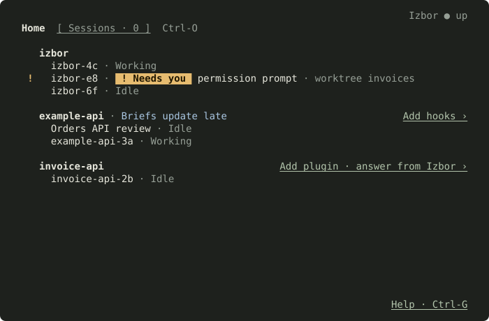
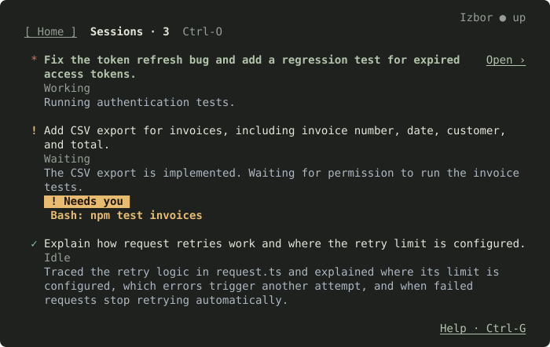
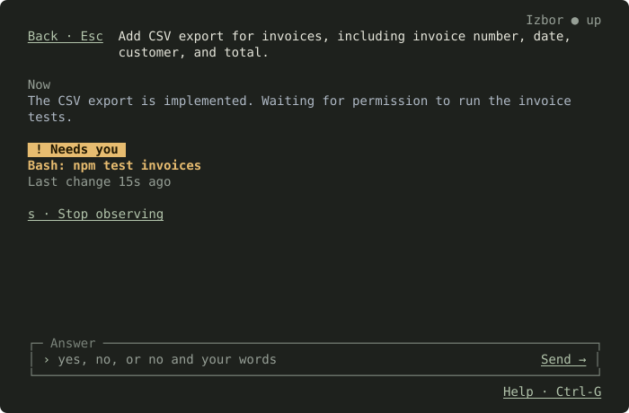
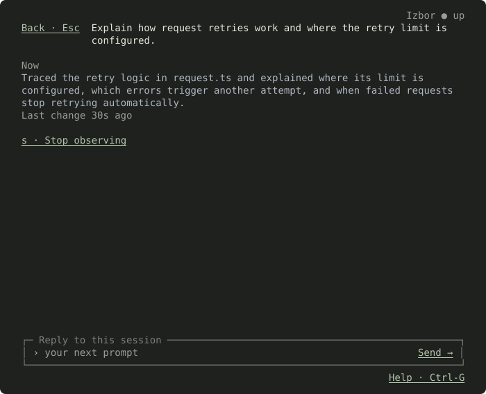
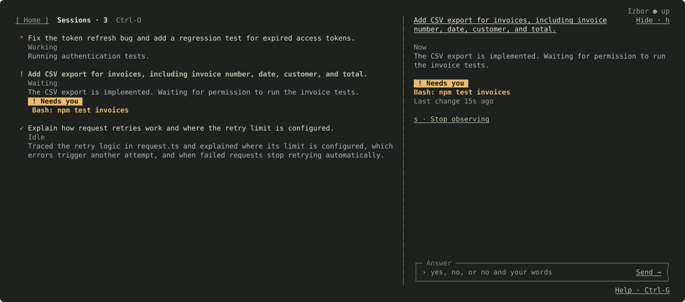

# Izbor terminal app

`izbor` opens a window in your terminal that shows your coding-agent sessions (today, Claude Code): what each one is doing, and which ones need you. You can answer a session's questions and send it messages from here.

Install it with the commands in the [main README](../../README.md#install). The guide's second half covers [connecting projects](#connect-a-project), [the service](#the-service), [data and Claude usage](#data-and-claude-usage), [troubleshooting](#troubleshooting), [updating](#update) and [removing Izbor](#remove-izbor).

The exact behaviour of every screen, message and key is in [SPEC.md](SPEC.md).

## The screens

The app has three screens, plus Help. Switch between Home and Sessions with **Ctrl-O** or a click on a tab. **Esc** goes one step back. The pictures below show sample sessions.

### Home: every running session



Every agent session on your computer, grouped by project.

- **`! Needs you`** (amber): this session is waiting for you, here for a permission.
- **`Open ›`**: you already observe this session. Press **Enter** or click to see its Brief.
- **`Observe ›`** appears on a session you don't observe yet. Press **Enter** or click to start.
- **`Add hooks ›`** on a project: Izbor gets no live events from this project yet, so its Briefs update late. Click it once to connect the project.
- **`Add plugin · answer from Izbor ›`**: Izbor sees the project, but you can't answer from here yet. Click it once to allow that.

### Sessions: the ones you observe



One block per session:

1. **What you asked**, in white.
2. **Its state**: Working, Waiting or Idle.
3. **What Claude did**, in blue.
4. If it waits for you: the amber **`! Needs you`** badge and what it asks, here `Bash: npm test invoices`.

The mark in front tells the state at a glance:

| Mark | Meaning                                            |
| ---- | -------------------------------------------------- |
| `!`  | Needs you                                          |
| `*`  | Working                                            |
| `✓`  | Idle: the last reply is finished                   |
| `?`  | Unknown                                            |
| `▲`  | Izbor can't follow it right now; the line says why |

Press **Enter** or click a session to open its Brief.

### Brief: one session in full

**When the session asks for something**, the box at the bottom is titled `Answer`. Type `yes`, `no`, or `no` and a reason, then press **Enter**.



**When it doesn't**, the box is `Reply to this session`. What you type goes to Claude as your next message. If Claude is busy, it runs when the current turn ends.



While a send is pending, you can edit the field or open another Brief. Its eventual success clears only the draft you sent; new text stays, even if you typed the same words again. Quitting cancels pending key reads and send requests.

Press **s** to stop observing (the session keeps running), **m** for details such as exact times, and **Esc** to go back.

### Wide window: list and Brief side by side

In a window of 140 × 20 or more, the selected session's Brief sits next to the list.



### Help

**Ctrl-G** or a click on `Help` at the bottom right lists every key. Close it the same way.

## The top line

- `Izbor ● up`: everything works.
- `▲ Izbor ○ not running on port 4319 · run izbor`: the Izbor service is off. Run `izbor` again.
- `▲ old build · run npm run build`: the code changed since the last build.

## Common messages

| Message                                          | What to do                                                                                                                         |
| ------------------------------------------------ | ---------------------------------------------------------------------------------------------------------------------------------- |
| `This project has no plugin…`                    | On Home, use `Add plugin · answer from Izbor ›` on that project.                                                                   |
| `Type /reload-plugins in this session once…`     | The session started before the plugin was added. Run `/reload-plugins` in that session, or restart it with `claude --resume <id>`. |
| `Briefs update late: add hooks for live updates` | On Home, use `Add hooks ›` on that project.                                                                                        |
| `Answer in Claude Code: …`                       | Izbor can't answer this request; answer it in the session itself.                                                                  |
| `That request still waits…`                      | Your answer didn't reach the session; answer it there.                                                                             |

## Keys

| Key                        | Does                                       |
| -------------------------- | ------------------------------------------ |
| Up / Down                  | Move between lines                         |
| Enter / click              | Open, observe, or send                     |
| Esc                        | Step back                                  |
| Ctrl-O                     | Switch Home and Sessions                   |
| Tab                        | Move focus between list, Brief and its box |
| m                          | Show or hide a Brief's details             |
| h                          | Hide the Brief                             |
| s                          | Stop observing the session                 |
| Page Up / Page Down, wheel | Scroll                                     |
| Ctrl-G                     | Help                                       |
| Ctrl-C                     | Quit                                       |

## Options

```sh
izbor                  # the live app
izbor --no-mouse       # leave the mouse and text selection to your terminal
izbor --no-bell        # no sound when a session starts needing you
izbor --no-color       # no colours
izbor --version        # when this checkout was last built
```

## Signals outside the window

- The terminal tab's title becomes `Izbor · needs you` while an observed session waits for you.
- The bell rings once when an observed session starts waiting. Turn it off with `--no-bell`.

## Window size

| Window                          | You see                                    |
| ------------------------------- | ------------------------------------------ |
| Smaller than 40 × 12            | A message asking for a bigger window       |
| Up to 139 columns or 19 rows    | One screen at a time                       |
| 140 columns and 20 rows or more | The Sessions list with the Brief beside it |

## Connect a project

Izbor lists every running session, but it follows a project closely only once you connect it. On Home, choose `Add hooks ›` on the project's line, then `Add plugin · answer from Izbor ›` if you want to answer and prompt its sessions from Izbor. Or run the same steps from a terminal, which also works for a project with no session open yet:

```sh
izbor hooks "/path/to/project"     # Claude Code events reach Izbor
izbor plugin "/path/to/project"    # answers and prompts reach the sessions
```

Without a folder, both commands use the current folder. `hooks` writes Izbor's event hooks to the project's `.claude/settings.local.json`; `plugin` installs Izbor's plugin and answer hook there. Add `--remove` to undo either. For a folder that starts with a dash, put `--` before it: `izbor hooks -- -project`.

Running sessions post to Izbor from their next hook. A session that started before the plugin was added takes answers from its next request; to send it prompts, type `/reload-plugins` in it once, or start a new session.

The hooks and the plugin point at the checkout by its absolute path, so do not move or delete the checkout while projects are connected.

## The service

`izbor` starts the Izbor service in the background if none runs, then opens the app. Quitting the app leaves the service running.

```sh
izbor status                # whether it runs, its data folder and what it watches
izbor status --disk-usage   # also the size of the stored history
izbor stop                  # stop the service; --yes skips its question
izbor serve                 # run the service in this terminal instead
```

Stopping Izbor does not stop your Claude Code sessions. The service listens on `127.0.0.1:4319`. Use `--port` or the `IZBOR_PORT` variable for another port, and pass the same `--port` to `status`, `stop`, `hooks` and `plugin`.

## Data and Claude usage

- The service listens only on `127.0.0.1`, and refuses requests addressed to any host but `127.0.0.1` or `localhost`.
- Izbor saves observed session records, hook payloads and its log, `izbor.log`, in `.izbor/` inside the checkout. These can contain prompts, replies, file paths, and tool inputs and outputs. Set `IZBOR_DATA_DIR` to an absolute path to use a different folder; `izbor status` shows the folder in use.
- A port file and private send keys live in `~/.config/izbor` on macOS, or `%LOCALAPPDATA%\izbor` on Windows. They let the plugin find the service and authorize your answers.
- Izbor sends no telemetry and checks for no updates. Currently, the explanation under `Now` comes only from Claude Haiku: to write it, Izbor sends session-derived text through the Claude Agent SDK and your own `claude` login. These requests use your Claude subscription's usage and fall under Anthropic's usage and data policies.

Session records, `izbor.log` and the per-user files can contain private data; do not post them in public bug reports.

## Troubleshooting

| What you see                                                                             | What to do                                                                                                                                                      |
| ---------------------------------------------------------------------------------------- | --------------------------------------------------------------------------------------------------------------------------------------------------------------- |
| `izbor needs Node 24.3.0 or later`                                                       | Install Node 24.3.0 or later, then run `npm ci` and `npm run build` in the checkout again.                                                                      |
| `izbor has no build to run`                                                              | Run `npm run build` in the checkout.                                                                                                                            |
| `▲ old build · run npm run build`, or `Izbor started before your last build`             | Run `npm run build`, then `izbor stop` and `izbor`, so the service uses the new build.                                                                          |
| `Interactive mode needs a terminal.`                                                     | Run `izbor` in a terminal window, without redirected input or output. Use `izbor serve` to run the service alone.                                               |
| `▲ No list:` on Home, followed by a reason                                               | Check that `claude` is on your PATH, that `claude agents --json` works in a terminal, and that you are logged in. Update Claude Code if the command is missing. |
| `▲ Izbor ○ port 4319 held by another program`, or `Port 4319 answers, but not as Izbor.` | Start Izbor on another port with `--port 5000` or `IZBOR_PORT`, and pass the same `--port` to `status`, `stop`, `hooks` and `plugin`.                           |
| `Another Izbor is using this data folder`                                                | Stop it with `izbor stop --port <its port>`, or set `IZBOR_DATA_DIR` to a different absolute path.                                                              |
| `Explanation unknown ·` followed by a reason, or no sentence under `Now`                 | Check that `claude` works, is logged in and has usage left, then read the reason and `izbor.log`.                                                               |
| `izbor status` prints `Izbor is not running.`                                            | The service is stopped, and `status` exits with code 3. Run `izbor` to start it.                                                                                |
| Your shell cannot find `izbor`                                                           | Run `npm install --global .` in the checkout, and check that npm's global command folder is on your PATH.                                                       |

For anything else, see [Report a problem](../../CONTRIBUTING.md#report-a-problem).

## Update

Close Izbor's windows, then run from the checkout:

```sh
izbor stop
git pull --ff-only
npm ci && npm run build
izbor
```

If you move the checkout, run `npm install --global .` from its new place, then `izbor hooks` and `izbor plugin` again in each connected project. If an update changes the plugin, run `izbor plugin --remove` and `izbor plugin` in each project that has it, then restart those sessions or type `/reload-plugins`.

## Remove Izbor

Disconnect each project you connected; run `plugin --remove` only where you added the plugin. Your other local Claude settings stay.

```sh
izbor plugin --remove "/path/to/project"
izbor hooks --remove "/path/to/project"
izbor stop
npm uninstall --global izbor
```

Then delete the checkout. Its `.izbor/` folder holds the saved session history; copy it first if you want to keep it. A custom `IZBOR_DATA_DIR` and the per-user folder (`~/.config/izbor`, or `%LOCALAPPDATA%\izbor` on Windows) remain until you delete them yourself. Stop every Izbor service before deleting the per-user folder.

```sh
rm -rf .izbor ~/.config/izbor                      # macOS, from the checkout
Remove-Item -Recurse .izbor, $env:LOCALAPPDATA\izbor  # Windows PowerShell
```
